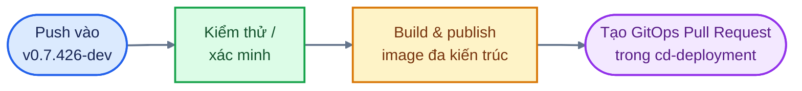

# BÁO CÁO KẾT QUẢ KIỂM THỬ CI/CD

## Huly Platform — Huly Mobile BFF và Flutter Web

| Thuộc tính | Thông tin |
| --- | --- |
| Loại tài liệu | Báo cáo kết quả kiểm thử CI/CD |
| Repository | [`istt-aiml-data/platform`](https://github.com/istt-aiml-data/platform) |
| Nhánh nguồn được kiểm tra | `v0.7.426-dev` |
| Đối tượng kiểm tra | Huly Mobile BFF; Huly Mobile Flutter Web |
| Nguồn bằng chứng | GitHub Actions run history, workflow definition và job log |
| Ngày lập báo cáo | 29-10-2026 |
| Múi giờ hiển thị | ICT (UTC+7), trừ log gốc của GitHub Actions là UTC |

---

## 1. Mục đích

Tài liệu này ghi nhận kết quả kiểm thử và đóng gói container đã hoàn tất thành công cho Huly Mobile BFF và Huly Mobile Flutter Web. Mỗi kết quả được đối chiếu với run GitHub Actions, commit nguồn, log kiểm thử, image digest và Pull Request GitOps được tạo từ workflow.

Đây là báo cáo kết quả. Nội dung chỉ phản ánh trạng thái đã quan sát tại thời điểm kiểm tra; không bao gồm đánh giá rủi ro, đề xuất thay đổi hoặc quyết định triển khai.

## 2. Phạm vi kiểm tra

| Thành phần | Workflow | Nội dung đã đối chiếu |
| --- | --- | --- |
| Huly Mobile BFF | `Huly Mobile BFF container release` | Trạng thái workflow, pytest, container image, GitOps promotion và điều kiện smoke test |
| Huly Mobile Flutter Web | `Huly Mobile Flutter Web container release` | Trạng thái workflow, Flutter analyze/test, container image, GitOps promotion và điều kiện smoke test |

Các workflow CoWork, Ingestion và Retrieval không thuộc phạm vi của báo cáo này.

## 3. Phương pháp xác minh

Kết quả được xác minh qua các nguồn sau:

1. Metadata của GitHub Actions run: workflow, trigger, branch, commit, thời điểm, thời lượng và kết quả cuối cùng.
2. Log của job kiểm thử để xác nhận số lượng test và trạng thái pass/skip/fail.
3. Cấu hình workflow để xác nhận mối quan hệ giữa job test, build, publish image và GitOps promotion.
4. Metadata image đã publish: registry, tag theo commit, digest, kiến trúc và attestation.
5. Pull Request trong `cd-deployment` do workflow tạo.

Luồng được xác minh trong báo cáo:



## 4. Kết quả kiểm tra: Huly Mobile BFF

### 4.1. Thông tin run

| Thuộc tính | Kết quả |
| --- | --- |
| Workflow | `Huly Mobile BFF container release` |
| GitHub Actions run ID | `40801572604` |
| Trigger | Push vào `v0.7.426-dev` |
| Source commit | `ff24b467fe63bcb26464176278b7090d93227cbb` |
| Trạng thái tổng thể | `success` |
| Thời lượng | 25 phút 42 giây |
| Bắt đầu | 08:37, 29-10-2026 (ICT) |
| Hoàn tất | Khoảng 09:03, 29-10-2026 (ICT) |

### 4.2. Kết quả job kiểm thử

Job kiểm thử có tên `Test Mobile BFF`. Môi trường test sử dụng Python 3.12, dependency được cài bằng `uv sync --frozen --group dev`, với biến môi trường `TESTING=1` và `USE_SQLITE=1`.

Kết quả gốc từ GitHub Actions log:

```text
============================= test session starts ==============================
collecting ... collected 399 items
================== 386 passed, 13 skipped in 60.47s (0:01:00) ==================
```

| Chỉ số kiểm thử | Kết quả |
| --- | --- |
| Tổng số test được thu thập | 399 |
| Passed | 386 |
| Skipped | 13 |
| Failed | 0 |
| Thời gian pytest | 60.47 giây |

### 4.3. Quan hệ giữa test và release

Workflow khai báo release job phụ thuộc vào test job thông qua `needs: test`. Lệnh pytest không có cơ chế bỏ qua lỗi trong workflow đã kiểm tra.

| Hạng mục workflow | Trạng thái đã xác minh |
| --- | --- |
| Test job hoàn tất | Thành công |
| Release job chờ test job | Có, qua `needs: test` |
| Pytest failure được bỏ qua | Không |
| Build/publish sau test | Đã hoàn tất trong run `40801572604` |

### 4.4. Kết quả image container

| Thuộc tính | Kết quả |
| --- | --- |
| Image repository | `ghcr.io/istt-aiml-data/huly-mobile-bff` |
| Image tag | `sha-ff24b467fe63bcb26464176278b7090d93227cbb` |
| Image digest | `sha256:bbcb879df0a9960c36ef18da1033fee69e17f704c0178001ca121bcdfc93e8bf` |
| Kiến trúc đã publish | `linux/amd64`, `linux/arm64` |
| SBOM | Enabled |
| Provenance | Enabled |

### 4.5. Kết quả GitOps promotion

Workflow đã tạo Pull Request cập nhật image digest trong repository GitOps:

| Thuộc tính | Kết quả |
| --- | --- |
| Repository đích | `istt-aiml-data/cd-deployment` |
| Pull Request | [#143](https://github.com/istt-aiml-data/cd-deployment/pull/143) |
| Image được tham chiếu | `ghcr.io/istt-aiml-data/huly-mobile-bff` |
| Digest được tham chiếu | `sha256:bbcb879df0a9960c36ef18da1033fee69e17f704c0178001ca121bcdfc93e8bf` |

### 4.6. Trạng thái smoke test trong run

Workflow có smoke-test job. Điều kiện chạy hiện tại chỉ cho phép job này chạy đối với Pull Request hoặc nhánh có tiền tố `feat/`.

| Hạng mục | Kết quả trong run đã kiểm tra |
| --- | --- |
| Run là Push vào `v0.7.426-dev` | Có |
| Run là Pull Request | Không |
| Nhánh bắt đầu bằng `feat/` | Không |
| Smoke test được thực thi | Không |
| Nguyên nhân | Không thỏa điều kiện chạy của workflow |

### 4.7. Bằng chứng ảnh từ GitHub Actions

Chèn ảnh chụp từ GitHub Actions run `40801572604` tại các vị trí sau:

| Mã ảnh | Ảnh cần chụp | Vị trí trong GitHub Actions |
| --- | --- | --- |
| BFF-01 | Workflow run có trạng thái `Success`, commit và branch | Trang **Summary** của run |
| BFF-02 | Kết quả `386 passed, 13 skipped` | Job **Test Mobile BFF**, bước chạy pytest |
| BFF-03 | Kết quả build/push image và digest | Job release, bước build/push container image |
| BFF-04 | Pull Request GitOps được tạo | Job release, bước tạo hoặc cập nhật GitOps PR |

> Dán ảnh ngay dưới bảng này, giữ tiêu đề ảnh theo mã `BFF-01` đến `BFF-04` để khớp với nội dung báo cáo.

## 5. Kết quả kiểm tra: Huly Mobile Flutter Web

### 5.1. Thông tin run

| Thuộc tính | Kết quả |
| --- | --- |
| Workflow | `Huly Mobile Flutter Web container release` |
| GitHub Actions run ID | `40631749295` |
| Trigger | Push vào `v0.7.426-dev` |
| Source commit | `643d0af799bf06521d951485bd6a3da864d5ff7e` |
| Trạng thái tổng thể | `success` |
| Thời lượng | 24 phút 17 giây |
| Bắt đầu | 11:20, 28-10-2026 (ICT) |
| Hoàn tất | Khoảng 11:44, 28-10-2026 (ICT) |

### 5.2. Kết quả Flutter analyze và test

Log workflow ghi nhận kết quả sau:

```text
No issues found! (ran in 100.1s)
00:08 +19: All tests passed!
```

| Chỉ số kiểm thử | Kết quả |
| --- | --- |
| Flutter analyze | Không phát hiện issue |
| Thời gian analyze | 100.1 giây |
| Flutter test | 19 passed |
| Failed | 0 |
| Thời gian Flutter test | 8 giây |

Bộ kiểm thử được ghi nhận trong workflow bao gồm các khu vực: touch target 44x44, reflow ở 320px, trạng thái Loading/Empty/Error/Data, hành động CoWork, timeline, recurrence/free-busy và meeting outcome.

### 5.3. Cách thực thi analyze và test trong workflow

Trong workflow đã kiểm tra, output của `flutter analyze` và `flutter test` được lưu vào log file. Hai lệnh có hậu tố `|| true`.

| Hạng mục workflow | Trạng thái đã xác minh |
| --- | --- |
| `flutter analyze` được chạy | Có |
| `flutter test` được chạy | Có |
| Log của run hiện tại | Analyze không có issue; 19 test passed |
| Lỗi của hai lệnh có thể làm fail job trực tiếp | Không, do có `|| true` |

### 5.4. Kết quả image container

| Thuộc tính | Kết quả |
| --- | --- |
| Image repository | `ghcr.io/istt-aiml-data/huly-mobile-flutter-web` |
| Image tag | `sha-643d0af799bf06521d951485bd6a3da864d5ff7e` |
| Image digest | `sha256:4384552de3b9003c51dee8a2dc46222056e97a9928f6293a358a790ff97f2782` |
| Kiến trúc đã publish | `linux/amd64`, `linux/arm64` |
| SBOM | Enabled |
| Provenance | Enabled |

### 5.5. Kết quả GitOps promotion

Workflow đã tạo Pull Request cập nhật image digest trong repository GitOps:

| Thuộc tính | Kết quả |
| --- | --- |
| Repository đích | `istt-aiml-data/cd-deployment` |
| Pull Request | [#133](https://github.com/istt-aiml-data/cd-deployment/pull/133) |
| Image được tham chiếu | `ghcr.io/istt-aiml-data/huly-mobile-flutter-web` |
| Digest được tham chiếu | `sha256:4384552de3b9003c51dee8a2dc46222056e97a9928f6293a358a790ff97f2782` |

### 5.6. Trạng thái smoke test trong run

Smoke test có trong workflow và cũng dùng điều kiện chỉ chạy cho Pull Request hoặc nhánh bắt đầu bằng `feat/`.

| Hạng mục | Kết quả trong run đã kiểm tra |
| --- | --- |
| Run là Push vào `v0.7.426-dev` | Có |
| Run là Pull Request | Không |
| Nhánh bắt đầu bằng `feat/` | Không |
| Smoke test được thực thi | Không |
| Chức năng smoke test khi được chạy | Kiểm tra `/healthz` và UID/GID `101:101` |

### 5.7. Bằng chứng ảnh từ GitHub Actions

Chèn ảnh chụp từ GitHub Actions run `40631749295` tại các vị trí sau:

| Mã ảnh | Ảnh cần chụp | Vị trí trong GitHub Actions |
| --- | --- | --- |
| FLUTTER-01 | Workflow run có trạng thái `Success`, commit và branch | Trang **Summary** của run |
| FLUTTER-02 | `No issues found!` và `19: All tests passed!` | Job kiểm tra Flutter, bước analyze/test |
| FLUTTER-03 | Kết quả build/push image và digest | Job release, bước build/push container image |
| FLUTTER-04 | Pull Request GitOps được tạo | Job release, bước tạo hoặc cập nhật GitOps PR |

> Dán ảnh ngay dưới bảng này, giữ tiêu đề ảnh theo mã `FLUTTER-01` đến `FLUTTER-04` để khớp với nội dung báo cáo.

## 6. Bảng tổng hợp kết quả

| Nội dung | Huly Mobile BFF | Huly Mobile Flutter Web |
| --- | --- | --- |
| GitHub Actions run | `40801572604` | `40631749295` |
| Trạng thái run | `success` | `success` |
| Commit nguồn | `ff24b467fe63bcb26464176278b7090d93227cbb` | `643d0af799bf06521d951485bd6a3da864d5ff7e` |
| Kết quả test | 386 passed, 13 skipped, 0 failed | 19 passed, 0 failed |
| Image đa kiến trúc | amd64 và arm64 | amd64 và arm64 |
| SBOM/provenance | Enabled | Enabled |
| GitOps Pull Request | [#143](https://github.com/istt-aiml-data/cd-deployment/pull/143) | [#133](https://github.com/istt-aiml-data/cd-deployment/pull/133) |
| Smoke test trong run | Không chạy do điều kiện workflow | Không chạy do điều kiện workflow |

## Phụ lục A — Tham chiếu run

- BFF run: `https://github.com/istt-aiml-data/platform/actions/runs/40801572604`
- Flutter Web run: `https://github.com/istt-aiml-data/platform/actions/runs/40631749295`

