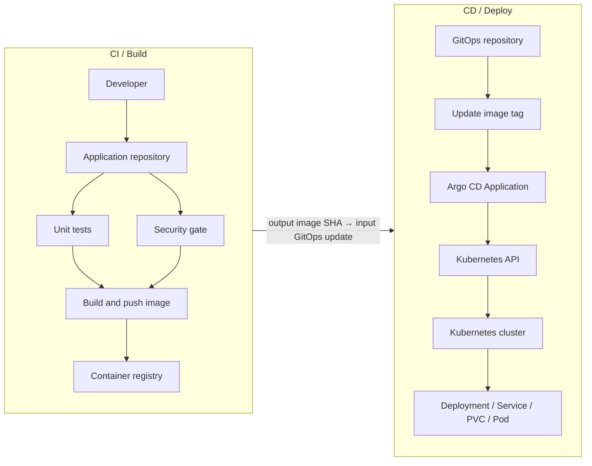
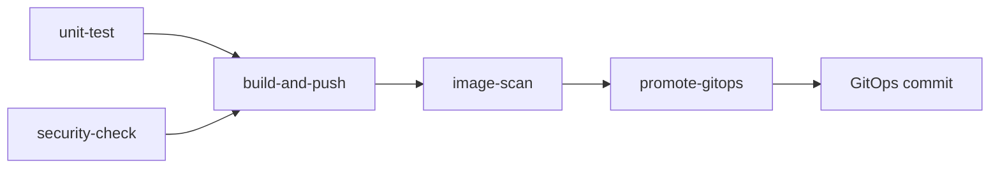
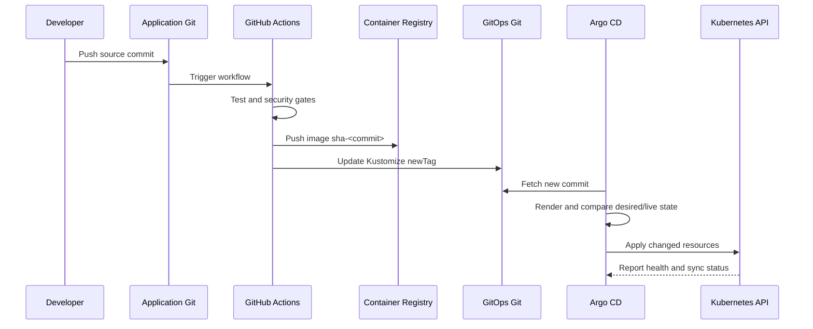
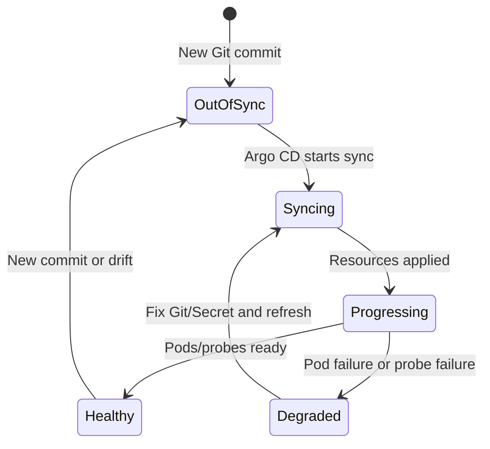
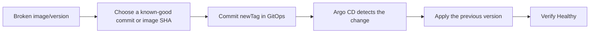

# Report: Understanding the Current CI/CD GitOps Flow

## 1. Objective

The current flow delivers a containerized application to Kubernetes following GitOps principles: application source code, container images, and deployment configuration are managed separately; Git is the source of truth for deployment configuration; and Argo CD continuously synchronizes the state declared in Git to Kubernetes.

This model reduces manual deployment work, provides a clear change history, supports Git-based rollback, and allows the cluster to converge on the declared desired state.

## 2. Components and responsibilities

| Component | Responsibility |
|---|---|
| Application repository | Contains application source code, Dockerfile, dependencies, tests, and GitHub Actions. |
| Container registry | Stores built Docker images tagged immutably by commit SHA. |
| GitOps repository | Contains Kubernetes manifests, Kustomize/Helm values, and Argo CD Applications. |
| GitHub Actions | Runs CI, builds and pushes images, and promotes image tags to the GitOps repository. |
| Argo CD | Watches the GitOps repository, renders manifests, and synchronizes resources to Kubernetes. |
| Kubernetes | Runs workloads, Services, PVCs, Secrets, and application dependencies. |
| Kubernetes Secret store | Holds database passwords, registry credentials, and SSH credentials; real secrets must not be committed to Git. |

The two repositories have separate responsibilities:

```text
Application repository: changes how the application is created.
GitOps repository:     changes how the application runs on Kubernetes.
```

## 3. Overall architecture



GitHub Actions does not deploy directly to the Kubernetes API. CI changes the image tag in the GitOps repository. Argo CD is the component that synchronizes GitOps state to the cluster.

## 4. CI flow: from source to image

The CI jobs have dependencies rather than being unrelated steps shown only in the user interface:



The flow is triggered when code is pushed to the deployment branch, normally `main`.

### 4.1. Unit test

CI checks out the source and runs tests appropriate for the application. For a template or a project without a complete test suite, this may initially be a minimum validation step; it should eventually be replaced or extended with real unit and integration tests.

Objectives:

- Confirm that the source, dependencies, and Dockerfile are valid.
- Detect functional issues before building an image.
- Stop promotion when tests fail.

### 4.2. Security check

CI checks dependencies and scans for accidentally committed secrets. Production environments should add dependency scanning, secret scanning, SAST, and license-policy checks.

Objectives:

- Prevent credentials from entering the image or Git.
- Detect known vulnerabilities in dependencies.
- Stop the pipeline when the configured risk threshold is exceeded.

### 4.3. Build and push image

After the preceding gates pass, CI uses Docker Buildx to build the image and pushes it to the registry with an immutable tag:

```text
sha-<git-commit-sha>
```

Generic example:

```text
ghcr.io/<organization>/<application>:sha-<commit-sha>
```

SHA tags provide exact traceability to the source commit, avoid ambiguity caused by mutable tags such as `latest`, and make rollback deterministic.

### 4.4. Image scan

After the image exists, the pipeline can scan it with Trivy or an equivalent scanner. This is an independent gate so that a scanner can be added without changing the promotion model.

Objectives:

- Detect CVEs in the base image and runtime packages.
- Block promotion when vulnerabilities exceed the accepted threshold.
- Store scan results as artifacts when audit evidence is required.

## 5. GitOps promotion flow

After the image is validated, the `promote-gitops` job:

1. Checks out the GitOps repository using a token with limited write access.
2. Enters the application's manifest directory.
3. Uses Kustomize to replace the image tag with the new `sha-<commit-sha>`.
4. Commits the image-tag change.
5. Pushes the commit to the GitOps branch, normally `main`.

Example Kustomize image configuration:

```yaml
images:
  - name: ghcr.io/<organization>/<application>
    newName: ghcr.io/<organization>/<application>
    newTag: sha-<commit-sha>
```

CI needs a secret such as `GITOPS_REPO_TOKEN` with permission to write repository contents. This token is not the Argo CD credential and is not used by Kubernetes to pull images.

## 6. CD flow: Argo CD synchronizes Kubernetes

The sequence for one image update is:



An Argo CD `Application` declares:

- The GitOps repository to watch.
- The branch or revision to follow.
- The manifest, Kustomize, or Helm path.
- The destination cluster and namespace.
- The synchronization policy.

Generic example:

```yaml
source:
  repoURL: git@github.com:<organization>/<gitops-repository>.git
  targetRevision: main
  path: <manifest-path>
destination:
  server: https://kubernetes.default.svc
  namespace: <application-namespace>
syncPolicy:
  automated:
    prune: true
    selfHeal: true
```

`https://kubernetes.default.svc` is the internal Kubernetes DNS name. It is not the public or SSH address of the control plane. Argo CD uses it because Argo CD runs inside the cluster.

When Argo CD detects a new Git commit, it:

1. Clones or fetches the GitOps repository.
2. Renders Kustomize or Helm.
3. Compares the desired state with the live cluster state.
4. Applies new or drifted resources.
5. Waits for resources to become healthy.
6. Reports `Synced`, `OutOfSync`, `Healthy`, `Progressing`, or `Degraded`.

## 7. Typical Kubernetes resources

A minimal stateless application usually requires:

```text
Namespace
Deployment
Service
ConfigMap or Secret
Kustomization
Argo CD Application
```

An application with a database or persistent data additionally requires:

```text
StatefulSet or managed database service
PersistentVolumeClaim
StorageClass
Database Secret
Backup/restore policy
```

Workloads using private images require an `imagePullSecrets` reference.

## 8. Secrets and access control

The flow has three distinct credential types:

| Credential | Used for | Stored in |
|---|---|---|
| GitOps promotion token | GitHub Actions writes the image tag to the GitOps repository | GitHub Actions Secret |
| Registry pull token | Kubernetes pulls a private image from the registry | Kubernetes `dockerconfigjson` Secret |
| Argo CD Git SSH key | Argo CD reads the GitOps repository | Kubernetes Secret in the Argo CD namespace |

Do not use one token for every purpose. Apply least privilege:

- The promotion token should only write to the GitOps repository.
- The registry token should only read packages/images.
- The Argo CD key should only read the GitOps repository.

If a token appears in a terminal, screenshot, or chat, revoke it immediately and create a replacement.

## 9. Conditions for automatic Argo CD deployment

The pipeline may successfully build, push, and promote an image while the workload still does not appear in Argo CD if the `Application` has not yet been registered in the cluster.

Fully automatic deployment normally has two layers:

```text
Root Application / app-of-apps
    └─ watches the GitOps repository root Kustomization
         └─ includes each application's application.yaml
              └─ Argo CD creates the Application and syncs the workload
```

Without app-of-apps, the application's `Application` must be applied once manually. After that initial registration, subsequent image-tag changes can be deployed automatically by Argo CD.

## 10. Observability and verification

The reconciliation lifecycle can be represented as:



### 10.1. Check CI

In GitHub Actions, verify the jobs in order:

```text
unit-test
security-check
build-and-push
image-scan
promote-gitops
```

If `promote-gitops` fails with HTTP 403, check that the token can write to the GitOps repository and is authorized for the organization.

### 10.2. Check GitOps

Verify that the new image tag has been committed to `kustomization.yaml`. This confirms that CI completed promotion.

### 10.3. Check Argo CD

```bash
kubectl -n argocd get applications
kubectl -n argocd describe application <application-name>
```

Expected status:

```text
SYNC STATUS: Synced
HEALTH STATUS: Healthy
```

### 10.4. Check Kubernetes

```bash
kubectl -n <namespace> get pods,svc,pvc
kubectl -n <namespace> get events --sort-by=.lastTimestamp
kubectl -n <namespace> logs deploy/<deployment-name>
```

Common states:

| State | Meaning and action |
|---|---|
| `ImagePullBackOff` | Check registry credentials, package permission, or image tag. |
| `CreateContainerConfigError` | A Secret/ConfigMap or one of its keys is missing. |
| `CrashLoopBackOff` | The application fails during startup; inspect logs. |
| Pending PVC | The StorageClass/PV could not provision the volume. |
| Argo CD `Progressing` | Resources were applied but are not Ready; inspect Pods/events. |
| Argo CD `OutOfSync` | Live state differs from desired state; inspect the diff and refresh. |

## 11. Accessing an application without Ingress

A `ClusterIP` Service is reachable only inside the cluster. For testing from an administration machine, use port-forward:

```bash
kubectl -n <namespace> port-forward svc/<service-name> <local-port>:<service-port>
```

Use the protocol provided by the Service. For example, port-forwarding HTTP port 80 must be opened with `http://`, not `https://`. An SSL error caused by opening HTTPS against an HTTP endpoint is not a Kubernetes error.

When a bastion is required, create an SSH tunnel from the laptop to the machine running port-forward. Use a different local port for each service to avoid conflicts.

## 12. Rollback and safe changes

Rollback also goes through Git; Pods should not be edited directly:



Because image tags are versioned by commit SHA, rollback is a Git change:

1. Select an image SHA that previously ran successfully.
2. Change `newTag` in the GitOps repository to that SHA.
3. Commit and push the change.
4. Argo CD synchronizes the previous image.

Do not edit a Deployment directly in the cluster: the change diverges from GitOps and may be overwritten by `selfHeal`. For larger manifest changes, use a branch and Pull Request before merging into `main`.

## 13. Conclusion

The current CI/CD GitOps flow separates three responsibilities:

```text
The Application repository builds the image.
The GitOps repository declares the image version and runtime configuration.
Argo CD synchronizes that declaration to Kubernetes.
```

This provides traceability from source commit to image SHA, from image SHA to GitOps commit, and from GitOps commit to Kubernetes state. With complete tests, security scanning, secret management, and app-of-apps, it forms a consistent and auditable foundation for deploying multiple services.
