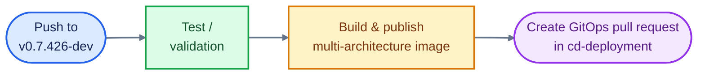

# CI/CD TEST RESULTS REPORT

## Huly Platform — Huly Mobile BFF and Flutter Web

| Attribute | Information |
| --- | --- |
| Document type | CI/CD test results report |
| Repository | [`istt-aiml-data/platform`](https://github.com/istt-aiml-data/platform) |
| Reviewed source branch | `v0.7.426-dev` |
| Reviewed components | Huly Mobile BFF; Huly Mobile Flutter Web |
| Evidence source | GitHub Actions run history, workflow definitions, and job logs |
| Report date | 29 October 2026 |
| Display timezone | ICT (UTC+7), except original GitHub Actions logs in UTC |

---

## 1. Purpose

This document records completed CI test and container-build results for Huly Mobile BFF and Huly Mobile Flutter Web. Each result is cross-checked against a GitHub Actions run, source commit, test log, image digest, and the GitOps pull request created by the workflow.

This is a results report. It records the observed state at the time of verification and does not contain risk assessments, recommendations, change proposals, or deployment decisions.

## 2. Verification scope

| Component | Workflow | Verified items |
| --- | --- | --- |
| Huly Mobile BFF | `Huly Mobile BFF container release` | Workflow status, pytest, container image, GitOps promotion, and smoke-test condition |
| Huly Mobile Flutter Web | `Huly Mobile Flutter Web container release` | Workflow status, Flutter analyze/test, container image, GitOps promotion, and smoke-test condition |

CoWork, Ingestion, and Retrieval workflows are outside the scope of this report.

## 3. Verification method

Results were verified using the following sources:

1. GitHub Actions run metadata: workflow, trigger, branch, commit, timestamps, duration, and final status.
2. Test-job logs to confirm pass, skip, and failure counts.
3. Workflow definitions to confirm the relationship between tests, image build/publish, and GitOps promotion.
4. Published-image metadata: registry, commit tag, digest, architectures, and attestations.
5. Pull requests created in `cd-deployment` by the workflows.

Verified flow:



## 4. Verification result: Huly Mobile BFF

### 4.1. Run information

| Attribute | Result |
| --- | --- |
| Workflow | `Huly Mobile BFF container release` |
| GitHub Actions run ID | `40801572604` |
| Trigger | Push to `v0.7.426-dev` |
| Source commit | `ff24b467fe63bcb26464176278b7090d93227cbb` |
| Overall status | `success` |
| Duration | 25 minutes 42 seconds |
| Started | 08:37, 29 October 2026 (ICT) |
| Completed | Approximately 09:03, 29 October 2026 (ICT) |

### 4.2. Test-job result

The test job is named `Test Mobile BFF`. It uses Python 3.12, installs dependencies through `uv sync --frozen --group dev`, and runs pytest with `TESTING=1` and `USE_SQLITE=1`.

Original GitHub Actions output:

```text
============================= test session starts ==============================
collecting ... collected 399 items
================== 386 passed, 13 skipped in 60.47s (0:01:00) ==================
```

| Test metric | Result |
| --- | --- |
| Collected tests | 399 |
| Passed | 386 |
| Skipped | 13 |
| Failed | 0 |
| Pytest duration | 60.47 seconds |

### 4.3. Test and release relationship

The workflow declares that the release job depends on the test job through `needs: test`. The reviewed workflow does not suppress pytest failures.

| Workflow item | Verified state |
| --- | --- |
| Test job completed | Successful |
| Release job waits for test job | Yes, through `needs: test` |
| Pytest failure is ignored | No |
| Build/publish after test | Completed in run `40801572604` |

### 4.4. Container image result

| Attribute | Result |
| --- | --- |
| Image repository | `ghcr.io/istt-aiml-data/huly-mobile-bff` |
| Image tag | `sha-ff24b467fe63bcb26464176278b7090d93227cbb` |
| Image digest | `sha256:bbcb879df0a9960c36ef18da1033fee69e17f704c0178001ca121bcdfc93e8bf` |
| Published architectures | `linux/amd64`, `linux/arm64` |
| SBOM | Enabled |
| Provenance | Enabled |

### 4.5. GitOps promotion result

The workflow created a pull request that updates the image digest in the GitOps repository.

| Attribute | Result |
| --- | --- |
| Target repository | `istt-aiml-data/cd-deployment` |
| Pull request | [#143](https://github.com/istt-aiml-data/cd-deployment/pull/143) |
| Referenced image | `ghcr.io/istt-aiml-data/huly-mobile-bff` |
| Referenced digest | `sha256:bbcb879df0a9960c36ef18da1033fee69e17f704c0178001ca121bcdfc93e8bf` |

### 4.6. Smoke-test status in the reviewed run

The workflow contains a smoke-test job. Its current condition permits execution only for pull requests or branches prefixed with `feat/`.

| Item | Result in the reviewed run |
| --- | --- |
| Run is a push to `v0.7.426-dev` | Yes |
| Run is a pull request | No |
| Branch starts with `feat/` | No |
| Smoke test executed | No |
| Recorded reason | The workflow execution condition was not met |

### 4.7. GitHub Actions screenshot evidence

Insert screenshots from GitHub Actions run `40801572604` in this section:

| Evidence ID | Required screenshot | GitHub Actions location |
| --- | --- | --- |
| BFF-01 | Successful workflow run, commit, and branch | Run **Summary** page |
| BFF-02 | `386 passed, 13 skipped` result | **Test Mobile BFF** job, pytest step |
| BFF-03 | Image build/push result and digest | Release job, container build/push step |
| BFF-04 | Created GitOps pull request | Release job, GitOps PR creation/update step |

> Paste the screenshots directly below this table and retain the identifiers `BFF-01` through `BFF-04`.

## 5. Verification result: Huly Mobile Flutter Web

### 5.1. Run information

| Attribute | Result |
| --- | --- |
| Workflow | `Huly Mobile Flutter Web container release` |
| GitHub Actions run ID | `40631749295` |
| Trigger | Push to `v0.7.426-dev` |
| Source commit | `643d0af799bf06521d951485bd6a3da864d5ff7e` |
| Overall status | `success` |
| Duration | 24 minutes 17 seconds |
| Started | 11:20, 28 October 2026 (ICT) |
| Completed | Approximately 11:44, 28 October 2026 (ICT) |

### 5.2. Flutter analysis and test result

The workflow log records the following output:

```text
No issues found! (ran in 100.1s)
00:08 +19: All tests passed!
```

| Test metric | Result |
| --- | --- |
| Flutter analyze | No issues found |
| Analyze duration | 100.1 seconds |
| Flutter tests | 19 passed |
| Failed | 0 |
| Flutter test duration | 8 seconds |

The workflow records coverage for 44x44 touch targets, 320px reflow, Loading/Empty/Error/Data states, CoWork actions, timeline, recurrence/free-busy, and meeting outcome behavior.

### 5.3. Analyze and test execution in the workflow

In the reviewed workflow, the output of `flutter analyze` and `flutter test` is written to log files. Both commands have the `|| true` suffix.

| Workflow item | Verified state |
| --- | --- |
| `flutter analyze` executed | Yes |
| `flutter test` executed | Yes |
| Current-run output | No analysis issues; 19 tests passed |
| Command failure directly fails the job | No, due to `|| true` |

### 5.4. Container image result

| Attribute | Result |
| --- | --- |
| Image repository | `ghcr.io/istt-aiml-data/huly-mobile-flutter-web` |
| Image tag | `sha-643d0af799bf06521d951485bd6a3da864d5ff7e` |
| Image digest | `sha256:4384552de3b9003c51dee8a2dc46222056e97a9928f6293a358a790ff97f2782` |
| Published architectures | `linux/amd64`, `linux/arm64` |
| SBOM | Enabled |
| Provenance | Enabled |

### 5.5. GitOps promotion result

The workflow created a pull request that updates the image digest in the GitOps repository.

| Attribute | Result |
| --- | --- |
| Target repository | `istt-aiml-data/cd-deployment` |
| Pull request | [#133](https://github.com/istt-aiml-data/cd-deployment/pull/133) |
| Referenced image | `ghcr.io/istt-aiml-data/huly-mobile-flutter-web` |
| Referenced digest | `sha256:4384552de3b9003c51dee8a2dc46222056e97a9928f6293a358a790ff97f2782` |

### 5.6. Smoke-test status in the reviewed run

The workflow contains a smoke-test job and uses the same pull-request or `feat/`-branch condition.

| Item | Result in the reviewed run |
| --- | --- |
| Run is a push to `v0.7.426-dev` | Yes |
| Run is a pull request | No |
| Branch starts with `feat/` | No |
| Smoke test executed | No |
| Smoke-test behavior when executed | Verifies `/healthz` and UID/GID `101:101` |

### 5.7. GitHub Actions screenshot evidence

Insert screenshots from GitHub Actions run `40631749295` in this section:

| Evidence ID | Required screenshot | GitHub Actions location |
| --- | --- | --- |
| FLUTTER-01 | Successful workflow run, commit, and branch | Run **Summary** page |
| FLUTTER-02 | `No issues found!` and `19: All tests passed!` | Flutter verification job, analyze/test step |
| FLUTTER-03 | Image build/push result and digest | Release job, container build/push step |
| FLUTTER-04 | Created GitOps pull request | Release job, GitOps PR creation/update step |

> Paste the screenshots directly below this table and retain the identifiers `FLUTTER-01` through `FLUTTER-04`.

## 6. Consolidated results

| Item | Huly Mobile BFF | Huly Mobile Flutter Web |
| --- | --- | --- |
| GitHub Actions run | `40801572604` | `40631749295` |
| Run status | `success` | `success` |
| Source commit | `ff24b467fe63bcb26464176278b7090d93227cbb` | `643d0af799bf06521d951485bd6a3da864d5ff7e` |
| Test result | 386 passed, 13 skipped, 0 failed | 19 passed, 0 failed |
| Multi-architecture image | amd64 and arm64 | amd64 and arm64 |
| SBOM/provenance | Enabled | Enabled |
| GitOps pull request | [#143](https://github.com/istt-aiml-data/cd-deployment/pull/143) | [#133](https://github.com/istt-aiml-data/cd-deployment/pull/133) |
| Smoke test in this run | Not executed due to workflow condition | Not executed due to workflow condition |

## Appendix A — Run references

- BFF run: `https://github.com/istt-aiml-data/platform/actions/runs/40801572604`
- Flutter Web run: `https://github.com/istt-aiml-data/platform/actions/runs/40631749295`

